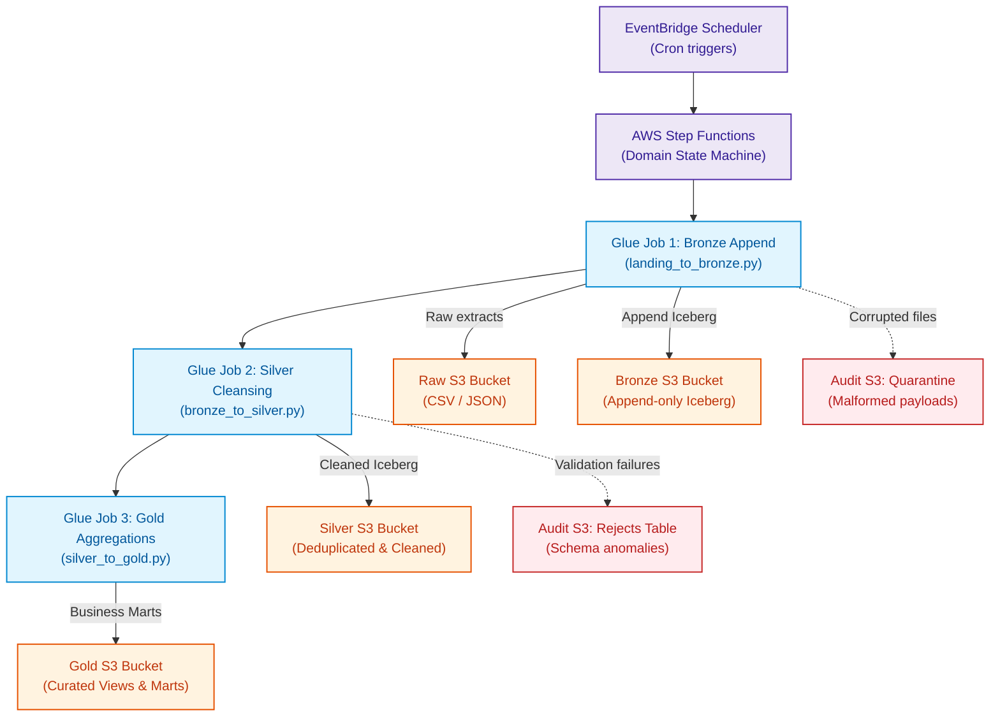

## Problem · Lakehouse scale without cross-domain data leakage

An enterprise utility infrastructure provider managed multi-domain operational data across field construction, customer billing, and supply chain logistics. The existing data environment struggled with three core architectural challenges:

1. **Lack of ACID guarantees on object storage:** Concurrent read/write pipelines on native S3 CSV/Parquet files frequently resulted in inconsistent reads, incomplete partitions during batch failures, and expensive full-table rewrites.
2. **Blast-radius and cross-domain compliance:** Engineering teams required strict domain isolation. Billing and field telemetry could not share encryption keys or IAM execution roles, yet enterprise analytics required consolidated dimensional reporting.
3. **Runaway idle compute costs:** Previous designs relied on persistent Spark clusters running 24/7, driving substantial compute waste during off-peak ingestion windows.

## Solution · Medallion architecture with Apache Iceberg and serverless ETL

The platform was architected around a 100% serverless Medallion pattern built on Apache Iceberg format:

```
 Landing (Raw) ──► Bronze (Append) ──► Silver (Cleaned & SCD2) ──► Gold (Aggregated Marts)
```

- **Raw Layer (Landing):** Native CSV/JSON extracts ingested via S3 event notifications with a strict 90-day lifecycle rule.
- **Bronze Layer (Ingestion):** AWS Glue PySpark jobs convert raw files into append-only Apache Iceberg tables, appending ingestion metadata and snapshot timestamps without mutating previous state.
- **Silver Layer (Single Source of Truth):** Enforces data quality rules, deduplicates records using Iceberg `MERGE INTO`, and manages Slowly Changing Dimensions (SCD Type 2) tracking. Corrupted rows are diverted to quarantined audit tables with error codes.
- **Gold Layer (Business Marts):** Dimensional star schemas and pre-computed analytical views optimized for Amazon Athena and BI dashboards.

## Architecture · Domain isolation and decoupled storage



### Implementation notes

- **Iceberg metadata tree:** Apache Iceberg separates table state into hierarchical metadata files (`Snapshots` $\rightarrow$ `Manifest Lists` $\rightarrow$ `Manifests` $\rightarrow$ `Data Files`). This eliminates expensive S3 `LIST` operations during query execution, reducing query planning time from minutes to milliseconds.
- **Partition evolution without rewriting:** Field operations frequently added new regional codes. Iceberg allowed changing table partition schemes without rewriting historical Parquet files or invalidating existing downstream queries.
- **Controlled bucket layout:** Rather than provisioning separate S3 buckets for every dataset, each business domain received five standardized buckets (`raw`, `bronze`, `silver`, `gold`, `audit`), isolating datasets into dedicated directory prefixes and Glue catalog namespaces.
- **Serverless state machine orchestration:** AWS Step Functions state machines coordinate multi-job execution with native retry blocks, exponential backoff, and Amazon SNS dead-letter alerting.

## Security · Dedicated KMS keys and least-privilege IAM

- **Domain-scoped CMKs:** Each business domain is encrypted under a dedicated AWS KMS Customer Managed Key (CMK). IAM execution policies explicitly deny cross-domain key usage, guaranteeing complete isolation at the storage layer.
- **S3 Bucket Keys enabled:** Activating S3 Bucket Keys reduced KMS API calls by over 98%, eliminating per-request cryptographic charges during multi-terabyte Spark batch operations.
- **Private network topology:** All ETL tasks execute within private subnets. Traffic to Amazon S3 routes through free S3 Gateway Endpoints, avoiding NAT Gateway hourly fees and data processing surcharges.

## Delivery · Modular Terraform infrastructure

The data platform infrastructure was engineered into 4 decoupled Terraform stacks:

1. **`01-network`:** Multi-AZ VPC, private isolated data subnets, route tables, and S3 Gateway VPC Endpoints.
2. **`02-data-platform`:** Domain-scoped S3 buckets, KMS keys, AWS Glue Catalogs, and audit logging repositories.
3. **`03-pipelines`:** Glue PySpark job definitions, Step Functions state machines, and EventBridge execution triggers.
4. **`04-governance`:** Centralized Athena workgroups, cost-control query limits, and IAM role boundaries.

## Trade-offs · Engine concurrency vs. file compaction

- **Small file compaction:** High-frequency streaming appends generate small Parquet files. Iceberg table maintenance required scheduling periodic maintenance jobs to run `rewrite_data_files` and expire obsolete snapshots, balancing write latency against read query performance.
- **Glue DPU autoscaling:** Serverless Glue DPUs offer zero idle costs, but require 1–2 minutes of container warm-up latency. For ultra-low latency requirements (<10 seconds), an event-driven Lambda micro-batching tier was required.
