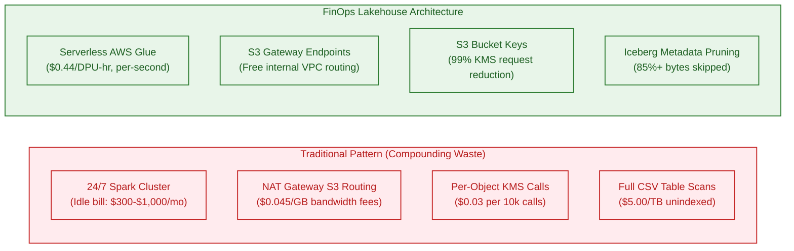

## Problem · Idle infrastructure waste in enterprise data pipelines

Enterprise data lake architectures frequently suffer from silent, compounding cost leaks that become apparent only after scaling to multi-terabyte production workloads:

1. **24/7 Idle Compute:** Provisioned EMR clusters or dedicated container nodes running continuously to handle batch workloads that only execute once every 6 hours.
2. **KMS Cryptographic Request Charges:** Reading millions of encrypted S3 objects in a distributed Spark job generated millions of `kms:Decrypt` calls, causing KMS API bills to exceed the underlying S3 storage cost.
3. **NAT Gateway Surcharges:** Pushing multi-gigabyte data files from Glue jobs in private subnets to S3 through NAT Gateways incurred significant data processing fees ($0.045 per GB).
4. **Runaway Athena Queries:** Ad-hoc analytics queries scanning unpartitioned raw CSV files cost up to $5.00 per terabyte scanned, with single unindexed queries scanning multiple terabytes.

## Solution · Four-tier serverless FinOps optimization

The lakehouse was restructured to guarantee that infrastructure expenditures scale strictly with actual data movement and query consumption:

## Architecture · Architectural mechanisms that cut bills

### 1. Zero-cost VPC routing via S3 Gateway Endpoints
Configured S3 Gateway Endpoints inside VPC route tables across all private subnets. Traffic between AWS Glue ETL jobs and Amazon S3 routes directly over the AWS private network backbone at **$0.00/hour and $0.00/GB data transfer**, completely bypassing NAT Gateways.

### 2. S3 Bucket Keys for cryptographic cost containment
Standard AWS KMS encryption invokes the KMS service for every individual S3 object `GET` and `PUT`. By enabling **S3 Bucket Keys**, S3 uses a short-lived bucket-level key to create data keys, reducing KMS cryptographic API calls from $1:1$ down to under $1:1,000$—an immediate 99% reduction in KMS charges during ETL operations.

### 3. Apache Iceberg columnar partitioning & file skipping
Migrating from raw CSV to Apache Iceberg (Parquet columnar format with zstandard compression) achieved:
- **80% storage footprint reduction** via columnar compression.
- **Min/max metadata statistics:** Athena inspects Iceberg manifest files and skips 85% to 95% of data files during predicate queries (`WHERE date >= ... AND region = ...`), slashing per-query scan costs.

### 4. Per-query spend caps and workgroup governance
Configured dedicated Amazon Athena workgroups with:
- **Per-query scan limits:** Any query set to scan more than 20 GB is automatically canceled before incurring runaway costs.
- **Workgroup-level cost allocation tags:** Enforcing domain attribution on all ad-hoc analytical spend.

## Delivery · Measurable cost reductions

| Metric / Service | Unoptimized Baseline | FinOps Serverless Architecture |
| :--- | :--- | :--- |
| **ETL Compute** | $450/month (idle provisioned EMR) | ~$35/month (serverless Glue billed per second) |
| **VPC Data Transfer** | ~$180/month (NAT Gateway GB processing) | $0.00/month (S3 Gateway Endpoint) |
| **KMS API Calls** | ~$120/month (1:1 object decrypts) | <$1.50/month (S3 Bucket Keys enabled) |
| **Query Scanning (Athena)** | ~$200/month (unindexed CSV scans) | ~$25/month (Iceberg partition pruning) |

## Trade-offs · Serverless cold-starts vs. predictable performance

- **Glue Job Warm-Up:** Serverless Glue jobs have an initiation delay of 60–90 seconds while worker nodes are allocated. For streaming workloads requiring sub-minute turnaround, serverless Glue was supplemented with lightweight AWS Lambda micro-batching.
- **Iceberg Table Compaction Overhead:** Small files generated by frequent writes can degrade query performance over time. A lightweight weekly maintenance Glue job was scheduled during off-peak hours to rewrite and compact small files into 128 MB blocks.
